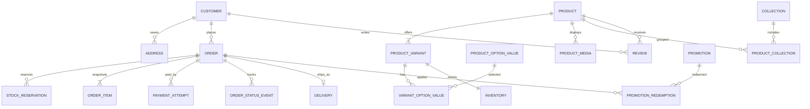

# Jetty's Hair — Database schema proposal

**Status:** Proposed implementation contract  
**Engine:** PostgreSQL 16+  
**Durable source of truth:** PostgreSQL for catalog, inventory, customers,
payment attempts, and orders. The client owns the disposable cart; the API
accepts its contents only as untrusted checkout input. Search indexes, caches,
and analytics projections are derived and rebuildable.

This schema supports the P0 launch scope in [FEATURES.md](./FEATURES.md), with
P1/P2 extensions called out inline. Use UUID primary keys, `timestamptz` in
UTC, foreign keys, and database constraints for invariants. Use migrations
checked into the application repository; never edit production schema by hand.

## Conventions and invariants

- Monetary amounts are `bigint` minor units (kobo for `NGN`), paired with an
  ISO 4217 `currency` column. Never use floating-point money.
- Product and variant prices are current catalog data. `order_items` and
  `orders` retain immutable snapshots of titles, SKUs, option labels, unit
  prices, discounts, shipping, and totals at purchase time.
- Use `numeric(5,2)` for percentage rates. Quantities are positive integers.
- Store normalized phone numbers in E.164 format. Email is case-insensitively
  unique when present. Guest orders may have no `customer_id`.
- Keep provider secrets outside the database. Store only provider customer
  tokens/references and redacted metadata.
- Soft-delete or deactivate customer/catalog records when history must remain
  referentially sound. Never cascade-delete completed orders.
- Place `created_at` and `updated_at` on mutable records. Append-only event,
  payment, and inventory ledgers are immutable except for retention-managed
  data.
- All stock mutation is transactional and guarded against negative
  `available_quantity`; checkout reservation uses row locks or an atomic
  conditional update.

## Entity map



Client-side carts and provider-side Paystack checkout UI are intentionally not
part of this PostgreSQL entity map.

## Tables

The list below defines the required logical shape. Names are snake_case.
`id` is UUID unless otherwise noted. Add standard timestamps where applicable.

### Identity and access

| Table | Required columns and constraints | Phase |
|---|---|---|
| `customers` | `id`, nullable `email`, nullable `phone_e164`, nullable `password_hash`, `status` (`active`, `blocked`, `pending_verification`), `email_verified_at`, `phone_verified_at`, `created_at`, `updated_at`; require at least email or phone; unique normalized email and phone when present; password may be absent for OTP-only accounts | P0 |
| `customer_sessions` | `id`, `customer_id`, `refresh_token_hash`, `expires_at`, `revoked_at`, `created_at`, `last_used_at`; never persist bearer/refresh tokens in plaintext | P0 |
| `auth_challenges` | `id`, nullable `customer_id`, `identifier`, `purpose`, `secret_hash`, `expires_at`, `attempt_count`, `consumed_at`, `created_at`; rate-limit and expire challenges | P0 |
| `customer_preferences` | `customer_id` PK/FK, `email_marketing`, `whatsapp_marketing`, `sms_marketing`, `updated_at`; record consent timestamp and source for each granted consent | P1 |
| `addresses` | `id`, `customer_id` nullable, `recipient_name`, `phone_e164`, `address_line1`, `address_line2`, `landmark`, `area`, `city`, `state`, `postal_code`, `country_code` default `NG`, `rider_note`, `is_default`; index `(customer_id, is_default)` | P0 checkout; P1 address book |
| `admin_users` | `id`, unique `email`, `password_hash`, `status`, `two_factor_secret_encrypted`, `two_factor_enabled_at`, timestamps | P0 |
| `admin_sessions` | `id`, `admin_user_id`, `refresh_token_hash`, `expires_at`, `revoked_at`, `created_at`, `last_used_at`; issue only after 2FA succeeds | P0 |
| `admin_roles` | `id`, unique `name` (`owner`, `manager`, `fulfilment`, `content_editor`, `support`), `permissions` JSONB | P1; P0 bootstrap owner |
| `admin_user_roles` | `(admin_user_id, admin_role_id)` PK/FKs | P1 |
| `admin_audit_log` | `id`, `admin_user_id`, `action`, `resource_type`, `resource_id`, `before_json`, `after_json`, `request_id`, `created_at`; append-only | P1 |

Do not store OTPs or password-reset tokens in plaintext. Persist only a
cryptographic hash, purpose, expiry, attempt count, and consumed timestamp;
expire records promptly. 2FA recovery codes are single-use hashes. Codes are
HMAC-keyed (not plain hashes), because a six-digit code is otherwise trivially
brute-forced from a leaked table. A code must also reach the worker, so it sits in the
`notification_outbox` payload until the message is sent or has failed, then is
removed; anything undelivered after ten minutes is expired and scrubbed.

### Catalog, merchandising, and inventory

| Table | Required columns and constraints | Phase |
|---|---|---|
| `products` | `id`, unique `slug`, `title`, `description`, `status` (`draft`, `active`, `archived`), `featured`, `badge_override`, `seo_title`, `seo_description`, `details_json`, `published_at`; index active products by `published_at` | P0 |
| `product_options` | `id`, `product_id`, `name` (e.g. length, lace, density, colour, cap size), `sort_order`, unique `(product_id, name)` | P0 |
| `product_option_values` | `id`, `option_id`, `label`, `value_key`, `price_delta_minor`, `sort_order`, `active`, unique `(option_id, value_key)` | P0 |
| `product_variants` | `id`, `product_id`, unique `sku`, `option_signature` (canonical JSONB), `price_minor`, nullable `compare_at_price_minor`, `currency`, `active`; unique `(product_id, option_signature)` | P0 |
| `variant_option_values` | `(variant_id, option_value_id)` PK/FKs; ensure each value belongs to an option on the same product in application validation or a database trigger | P0 |
| `product_media` | `id`, `product_id`, nullable `variant_id`, `object_key`, `alt_text`, `media_type`, `angle`, `sort_order`, `is_cover`, `width`, `height`; object contents live in object storage | P0 |
| `categories` | `id`, nullable `parent_id`, unique `slug`, `name`, `sort_order`, `active` | P0 |
| `product_categories` | `(product_id, category_id)` PK/FKs | P0 |
| `collections` | `id`, unique `slug`, `name`, `description`, `active`, `rules_json` nullable, `sort_order`; rules support automated collections if introduced | P0 |
| `product_collections` | `(product_id, collection_id)` PK/FKs, `sort_order` | P0 |
| `inventory` | `variant_id` PK/FK, `on_hand_quantity`, `reserved_quantity`, `low_stock_threshold`, `updated_at`; check `on_hand_quantity >= reserved_quantity >= 0` | P0 |
| `inventory_movements` | `id`, `variant_id`, `quantity_delta`, `reason`, nullable `order_id`, nullable `admin_user_id`, `reference`, `created_at`; immutable ledger | P0 |
| `stock_reservations` | `id`, `order_id`, `variant_id`, `quantity`, `expires_at`, `released_at`, `consumed_at`; unique active reservation per order/variant, indexed by expiry | P0 |
| `back_in_stock_subscriptions` | `id`, `variant_id`, nullable `customer_id`, `email`, `phone_e164`, `status`, `created_at`, `notified_at`; deduplicate active requests by variant/contact | P1 |
| `wishlists` | `id`, nullable `customer_id`, unique `guest_token_hash` nullable, timestamps; guest lists merge into customer list at login | P1 |
| `wishlist_items` | `(wishlist_id, variant_id)` PK/FKs, `created_at` | P1 |
| `saved_payment_methods` | `id`, `customer_id`, `provider`, `provider_customer_token`, `provider_method_token`, `brand`, `last_four`, `expiry_month`, `expiry_year`, `created_at`; unique provider method token; no PAN/CVV | P1 |

`available_quantity = on_hand_quantity - reserved_quantity`. Do not maintain a
second independently mutable available-stock value.

`product_variants.price_minor` is the sellable, fully resolved price for that
variant. Option `price_delta_minor` values are inputs to variant-matrix
generation/admin editing; the pricing engine reads the persisted variant
price, not an independently recomputed storefront value.

### Cart, pricing, and checkout

| Table | Required columns and constraints | Phase |
|---|---|---|
| `promotions` | `id`, `name`, `status`, `kind` (`percentage`, `fixed_amount`, `buy_x_get_y`, `free_delivery`, `free_gift`), `configuration` JSONB, `scope` JSONB, `starts_at`, `ends_at`, `priority`, `stackable`, `total_usage_limit`, `per_customer_limit`, `usage_count`, `first_order_only`, `minimum_subtotal_minor`, `currency`, `created_by_admin_id`; check start < end | P0 core types; P1 free gift/reporting |
| `promotion_codes` | `id`, `promotion_id`, unique normalized `code`, nullable `max_redemptions`, `redemption_count`, `active`; code required only for code-based promotions | P0 |
| `promotion_redemptions` | `id`, `promotion_id`, nullable `promotion_code_id`, nullable `customer_id`, `order_id`, `discount_minor`, `created_at`; unique `(promotion_id, order_id)` | P0 |
| `promotion_holds` | `id`, `promotion_id`, nullable `promotion_code_id`, nullable `customer_id`, `order_id`, `created_at`; unique `(promotion_id, order_id)` | P0 |
| `order_promotion_codes` | `(order_id, promotion_code_id)` PK/FKs; snapshots which codes were submitted for this order | P0 |

Promotion `configuration` and `scope` must be validated against versioned
application schemas. `scope` has this shape:

```json
{
  "include": {
    "allProducts": false,
    "productIds": ["uuid"],
    "collectionIds": ["uuid"]
  },
  "excludeProductIds": ["uuid"]
}
```

An empty `scope` or `include.allProducts: true` means all products before
exclusions. Validate that product and collection IDs exist and are active
when an admin saves a promotion; validate them again when evaluating it.
Never execute arbitrary expressions from JSON. Increment usage and write
`promotion_redemptions` atomically when an order is paid/accepted, not while a
shopper previews a quote. Enforce usage limits inside a transaction, first
come first served: checkout takes a `promotion_holds` row for each limited
promotion (under a row lock on the promotion/code) when `redemptions + open
holds < limit`, payment confirmation converts it into a redemption, and
reservation expiry deletes it. A limit therefore can never be oversubscribed.

The server calculates a quote from submitted variant IDs, quantities,
promotion codes, and delivery details. The client cannot set a price or assert
stock availability. When checkout begins, persist the resulting order and
immutable line/address/price/promotion snapshots before initializing
Paystack. These records are the transaction basis even if the browser
reloads or its local cart changes.

### Orders, payment, fulfilment

| Table | Required columns and constraints | Phase |
|---|---|---|
| `orders` | `id`, unique public `order_number`, nullable `customer_id`, nullable `guest_checkout_token_hash` and `guest_checkout_token_expires_at`, `status` (`pending_payment`, `placed`, `packed`, `out_for_delivery`, `delivered`, `cancelled`, `refunded`, `payment_exception`), `payment_status` (`pending`, `paid`, `failed`, `refunded`), `email`, `phone_e164`, `currency`, `subtotal_minor`, `discount_minor`, `delivery_fee_minor`, `tax_minor`, `total_minor`, `delivery_address_snapshot` JSONB, `delivery_method`, `applied_promotions` JSONB (immutable snapshot of promotions and code IDs applied at checkout; redemptions are written from it when payment is confirmed), `terms_accepted_at`, `placed_at`, timestamps | P0 |
| `order_items` | `id`, `order_id`, nullable `product_id`/`variant_id` (retain snapshot after catalog deletion), `sku_snapshot`, `title_snapshot`, `options_snapshot` JSONB, `quantity`, `unit_price_minor`, `discount_minor`, `line_total_minor`; check quantity > 0 | P0 |
| `payment_attempts` | `id`, `order_id`, `provider` (P0 `paystack`), `provider_reference` (unique), nullable `provider_transaction_id` (unique per provider when present), `method` (`card`, `bank_transfer`, `ussd`, `pay_on_delivery`, `other`), `status` (`initializing`, `pending`, `succeeded`, `failed`, `expired`, `refunded`), `amount_minor`, `currency`, `initialized_at`, `paid_at`, `metadata_redacted` JSONB; index `(order_id, created_at)` and unique `(provider, provider_reference)`; at most one active attempt per order | P0 card/transfer; P1 USSD/POD |
| `payment_webhook_events` | `id`, `provider`, non-null `provider_event_key`, `received_at`, `processed_at`, `processing_status`, `payload_redacted` JSONB; unique `(provider, provider_event_key)`; for Paystack derive the stable key from event type, reference, and transaction ID | P0 |
| `order_status_events` | `id`, `order_id`, `from_status`, `to_status`, `actor_type`, nullable `actor_id`, `note`, `created_at`; append-only | P0 |
| `deliveries` | `id`, `order_id` unique, `method`, `zone`, `status`, `carrier`, `rider_name`, `rider_phone_e164`, `tracking_reference`, `estimated_delivery_at`, `delivered_at` | P0 method/zone; P1 rider |
| `refunds` | `id`, `payment_attempt_id`, `order_id`, `amount_minor`, `reason`, `provider_reference`, `status`, `created_by_admin_id`, timestamps | P1 |
| `returns` | `id`, `order_id`, `customer_id`, `reason`, `status`, `items_json`, `requested_at`, `resolved_at` | P1 |

At checkout submission, generate an opaque guest checkout token when needed;
store only its hash and expiry on the order. Create a `pending_payment` order
and its line-item snapshots, create a pending `payment_attempt`, and reserve
stock in one PostgreSQL transaction. Then initialize Paystack using the
persisted reference, amount, currency, and customer email. If payment succeeds,
a verified webhook or server-side verification transactionally marks the
attempt succeeded, sets `orders.payment_status = paid` and
`orders.status = placed`, consumes
reservations, increments promotion redemptions, and appends the initial status
event. A failed attempt does not fail the order while retries are allowed:
leave order `payment_status = pending`, verify the previous attempt is
definitively failed/expired, then create a new attempt with a new provider
reference. Allow at most one initializing/pending attempt per order. If
initialization times out ambiguously, reconcile the existing reference with
Paystack before starting another attempt. Once the checkout/reservation
expires, set order status to `cancelled`, set payment status to `failed`, and
release reservations idempotently. If Paystack later confirms payment for a
cancelled order or a second attempt succeeds after the order is already paid,
record the successful charge, move the order to `payment_exception` when
appropriate, do not fulfill against released stock, and alert operations for
refund/reconciliation. Never discard a confirmed provider charge.

Paystack does not require a separate local `checkout_sessions` table or expose
a separate durable checkout-session ID in this design. The public order ID
identifies the local checkout record; `payment_attempts.provider_reference`
and `provider_transaction_id` hold Paystack correlation identifiers. Do not
duplicate provider IDs on `orders`. Store the Paystack `access_code` only as a
short-lived response to the client; it is not payment proof or a durable
identifier. Never trust the browser callback as payment proof.

### Reviews, content, delivery configuration, and operations

| Table | Required columns and constraints | Phase |
|---|---|---|
| `reviews` | `id`, `product_id`, `customer_id`, nullable `order_item_id`, `rating` 1–5, `title`, `body`, `location`, `status` (`pending`, `approved`, `rejected`, `hidden`), `verified_buyer`, `created_at`, `moderated_at`; unique `(order_item_id, customer_id)` when linked | P0 |
| `review_media` | `id`, `review_id`, `object_key`, `alt_text`, `status`, `sort_order` | P1 |
| `delivery_zones` | `id`, `name`, `state`, `areas` JSONB or normalized zone-area rows, `active`, `same_day_cutoff_local`, `timezone`, `same_day_fee_minor`, `next_day_fee_minor`, `nationwide_fee_minor`, `pickup_enabled`; rates/cutoff are configured, not hard-coded | P0 |
| `store_settings` | `key` PK, `value` JSONB, `updated_by_admin_id`, `updated_at`; allow-list keys and validate types in application code | P0 |
| `content_entries` | `id`, unique `(content_type, slug)`, `content_type`, `title`, `body` JSONB, `status`, `starts_at`, `ends_at`, `sort_order`, `created_by_admin_id`, timestamps | P0 announcements, heroes, static pages; P1 advanced sections |
| `content_placements` | `id`, `content_entry_id`, `placement`, `sort_order`, `settings` JSONB | P0 |
| `notification_outbox` | `id`, `event_type`, `recipient`, `channel`, `payload` JSONB, `status`, `attempt_count`, `next_attempt_at`, `sent_at`, `last_error`, `provider_message_id`, `created_at`; `status` is `pending`, `sending` (leased by a worker), `sent` or `failed`; indexed by `(status, next_attempt_at)` | P0 email; P1 WhatsApp |
| `analytics_events` | `id`, nullable `customer_id`, `anonymous_id`, `session_id`, `event_name`, `properties` JSONB, `occurred_at`; partition/retention strategy required at volume | P0 |
| `idempotency_keys` | `(scope, key)` unique, `request_hash`, `response_status`, `response_body` JSONB, `expires_at`, `created_at` | P0 |

Do not put secrets in `store_settings`. Limit analytics properties to
non-sensitive data; do not capture payment credentials, full addresses, or
unnecessary personal data.

### Client cart and checkout input

The storefront keeps its working cart in client-side state/storage and does
not call a server-side cart persistence API. Treat all client cart data as
untrusted input. At checkout, submit only the selected variant IDs and
quantities, promotion code(s), contact, delivery address/method, and terms
consent. Do not accept client prices, discounts, totals, product names, or
stock claims. The API validates each line and recalculates the whole quote
from PostgreSQL catalog, inventory, promotions, and delivery configuration.

```json
{
  "items": [
    {
      "variantId": "uuid",
      "quantity": 2
    }
  ],
  "promotionCodes": ["WELCOME"],
  "deliveryMethod": "same_day",
  "contact": {
    "email": "buyer@example.com",
    "phone": "+2348012345678"
  },
  "deliveryAddress": {
    "recipientName": "Buyer",
    "addressLine1": "12 Example Street",
    "area": "Lekki",
    "city": "Lagos",
    "state": "Lagos",
    "countryCode": "NG"
  },
  "termsAccepted": true
}
```

The client may persist a cart locally for convenience, but it is not
authoritative and can be lost or modified. No Redis service is required for
cart behavior.

For guest status polling, issue a high-entropy checkout access token in a
`Secure`, `HttpOnly`, `SameSite=Lax` cookie scoped to the checkout flow; store
only its hash and expiry on the order. Authenticated customers use normal
ownership checks. Do not expose full order details from a Paystack reference
alone.

## Required indexes and constraints

In addition to primary/unique keys above, create:

- `product_variants(product_id, active)` and a unique index on normalized SKU.
- `product_categories(category_id, product_id)` and
  `product_collections(collection_id, sort_order)`.
- `orders(created_at DESC)`, `orders(status, created_at DESC)`,
  `orders(customer_id, created_at DESC)`, unique `order_number`, and
  `payment_attempts(order_id, status)`.
- Unique `payment_attempts(provider, provider_reference)` and
  `(provider, provider_transaction_id)` when the transaction ID is non-null;
  partial unique index on `payment_attempts(order_id)` for active
  `initializing`/`pending` attempts.
- `reviews(product_id, status, created_at DESC)` and
  `promotions(status, starts_at, ends_at)`.
- Case-insensitive customer email uniqueness (`lower(email)`) for non-null
  values; unique E.164 phone for non-null values.
- Foreign keys on all relationships and checks for valid non-negative
  monetary values and quantities.

Use PostgreSQL full-text search for initial P0 product search, with a
documented synonym dictionary. A dedicated search service is an optional
scale-out, not the primary catalog store.

## Migration and acceptance checklist

1. Create tables and constraints in dependency order; each migration has a
   forward migration and a tested rollback strategy where practical.
2. Seed one owner admin, delivery zones, store settings, and catalog
   categories/collections through controlled scripts. Never seed credentials
   or production customer data.
3. Test that two concurrent checkout attempts cannot reserve the same last
   unit; expired unpaid orders release stock exactly once.
4. Test duplicate and out-of-order webhooks, failed payments, transfer
   confirmation, initialization timeouts, late/duplicate successful charges,
   promotion-limit races, and atomic order creation.
5. Verify deleting/deactivating a product or customer cannot erase completed
   order snapshots or break order tracking.
6. Add schema checks to CI and apply migrations in staging before production.
