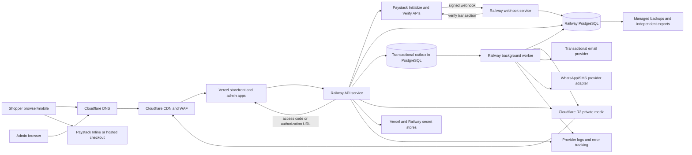

# Jetty's Hair — Infrastructure proposal

**Status:** Proposed reference deployment  
**Web hosting:** Vercel (storefront and admin)  
**Application/data hosting:** Railway (API, background worker, PostgreSQL)  
**Supporting services:** Cloudflare (DNS/CDN/WAF and R2 object storage)

This is a cost-conscious starting point, not a claim that the repository
already uses these providers. Use a modular monolith for the API and a
separate worker process. Do not introduce separate microservices until a
measured scaling or ownership need justifies their cost and operational
overhead.

Before committing, confirm the providers' current plans and region
availability, NDPR/data-residency requirements, payment-provider connectivity,
and measured end-user latency from Nigeria. Keep the Railway API and database
in the same region; configure Vercel server-side rendering close to that
region where the selected plan supports it.

## Proposed architecture

Deploy the storefront and admin as separate Vercel projects (or as separate
applications in one project only if the monorepo framework supports that
cleanly). Deploy API and worker as separate Railway services from the same
versioned codebase. Route dedicated hostnames such as `www`, `admin`, `api`,
and `media`; all clients use the same versioned API contract.

## Components and responsibilities

| Component | Proposal | Requirements |
|---|---|---|
| Storefront/admin | Vercel projects connected to the monorepo | Preview deploys per pull request; production deploy from protected main; use SSR/ISR selectively; keep Paystack secret key and transaction initialization out of browser code |
| API | Railway service | Stateless app; health/readiness endpoints; custom domain and TLS; size CPU/memory against measured load; API is authoritative writer for commerce data |
| Database | Railway managed PostgreSQL | Same region as API; TLS; least-privilege credentials; enable provider backups; verify retention and point-in-time restore limits on the selected plan |
| Background jobs | Railway worker using PostgreSQL transactional outbox | Persist jobs/outbox rows in the same transaction as commerce changes; bounded retries, backoff, deduplication, and failed-job visibility |
| Scheduled work | Railway cron/scheduled service or worker scheduler | Expire stock reservations, process scheduled promotions, and run review requests/exports; make every scheduled action idempotent |
| Media storage | Cloudflare R2 private bucket | Short-lived presigned upload intents; validate type/size; scan uploads; create WebP/AVIF derivatives in worker; immutable object keys and lifecycle rules |
| DNS/CDN/WAF | Cloudflare | TLS, WAF/rate limits, static asset caching; cache only public read-only catalog responses, never customer/cart/checkout/admin responses |
| Cart | Client-side storefront state/storage | No server-side cart table, Redis service, or cart persistence API; client submits variant IDs/quantities and checkout inputs, which the API revalidates |
| Payments | Paystack API and webhook | API initializes/verifies transactions with the secret key; browser uses returned access code or authorization URL; verify `x-paystack-signature`, then verify transaction/reference/amount/currency server-side |
| Email/messaging | Resend/Postmark or equivalent; WhatsApp Business/SMS adapter | Transactional sends from outbox worker; record provider message IDs/failures; marketing sends require recorded consent |
| Error monitoring | Sentry or equivalent plus provider logs/metrics | Structured JSON logs, request IDs, error/latency dashboards and alerts; redact tokens, OTPs, card data, and unnecessary PII |
| CI/CD | GitHub Actions tests plus Vercel/Railway Git integrations | Run checks before deploy; use environment-scoped deploy credentials if CI deploys directly; keep staging and production credentials isolated |

The browser owns the working cart and may persist it locally for shopper
convenience. Treat it as untrusted: every quote and checkout submission
revalidates variants, prices, promotions, delivery, and stock against
PostgreSQL. At checkout, persist the pending order snapshot, payment attempt,
and stock reservation before calling Paystack. The order and Paystack
reference allow webhook reconciliation even if the browser closes or clears
its local cart.

The transactional outbox in PostgreSQL is the durable job source; a separate
queue product is not required for launch. Workers claim rows safely, retry
temporary errors with backoff, and expose exhausted jobs for inspection and
replay. Add a managed queue only when measured volume or throughput requires
it.

## Environment layout

| Environment | Hosting | Data and credentials |
|---|---|---|
| Local | Local development; optional Railway dev services | Synthetic data and developer-only secrets; never production credentials |
| Staging | Separate Vercel project/environment and Railway project/environment | Separate database and R2 bucket/prefix; Paystack test keys; synthetic data |
| Production | Restricted Vercel and Railway production projects | Live Paystack secret/public keys; restricted operator access; alerting and audited changes |

If provider plan limits make fully isolated projects impractical initially,
keep at least separate databases, buckets, domain names, credentials, and
payment-provider environments. Never copy production customer data to staging.

## Network and trust boundaries

- Expose only the API over HTTPS. Keep PostgreSQL on Railway private networking
  and disable public database access unless a documented operational need
  requires it.
- Use Railway private networking between API, worker, and database where
  available on the selected plan. Restrict database credentials to the
  required services.
- Protect the admin app with mandatory 2FA and application-level permissions;
  edge access rules are additional protection, not authorization.
- The worker (`npm run start:worker`) runs a one-minute maintenance pass:
  release expired stock reservations and promotion holds, and delete expired or
  abandoned idempotency keys.
- Paystack calls a dedicated webhook service, a separate process and Railway
  service from the public API (`npm run start:webhook`, own `PORT`, no CORS or
  browser routes). It verifies `x-paystack-signature` over the raw body,
  persists/deduplicates the event, then verifies transaction state and amount
  server-to-server and applies the shared settlement transaction. It needs
  `DATABASE_URL` and `PAYSTACK_SECRET_KEY` (and `PAYSTACK_WEBHOOK_SECRET` only
  if a separate signing secret exists). It answers `503` when verification is
  unavailable so Paystack redelivers.
- Clients upload directly to private R2 using API-issued, short-lived signed
  intents. The client cannot list buckets or choose arbitrary object keys.
- Do not rely on local filesystem persistence for uploads or application
  state; Vercel/Railway application instances may be replaced at any time.

## Release flow

1. GitHub Actions runs formatting, type checks, unit/integration tests (pricing
   and checkout are launch gates), and dependency/security scans.
2. Deploy the commit to staging through Vercel and Railway. Run additive
   database migrations before or during the rollout using the documented
   migration command.
3. Smoke-test browse/search, pricing, stock reservation, checkout, signed
   payment webhook, guest tracking, admin operations, and notification
   outbox.
4. Promote the tested commit to production. Use expand/migrate/contract for
   schema changes; never deploy code that requires a destructive migration
   before all old application instances have been replaced.
5. Use provider health checks and deployment rollback controls where
   available. Document the manual rollback path and verify it before launch.
   Feature flags gate incomplete P1/P2 behavior.
6. Check error/latency dashboards, database health, payment webhook success,
   and outbox backlog after release; record release and migration versions.

Configure provider-connected deployments so a pull request does not publish
to production. Production deploys require protected-branch review. If using
GitHub Actions to deploy, store narrowly scoped credentials as protected
environment secrets and rotate them.

## Reliability and data protection

- Prefer hosted checkout or provider-hosted tokenization. Never collect or
  store PAN/CVV; store only provider tokens/references and redacted metadata.
- Require 2FA for all admin users. Hash passwords and OTP/reset tokens; keep
  provider secrets in provider secret stores, not source code or images.
- Enforce HTTPS; verify encryption-at-rest and backup encryption for selected
  provider plans. Use separate credentials for application, migrations, and
  read-only reporting where practical.
- Outbox handlers are at-least-once and idempotent. Alert on old/unprocessed
  outbox rows, repeated payment webhook failures, failed media jobs, and
  reservation expiry failures.
- Set retention/deletion rules for analytics, logs, customer data, and media.
  Support NDPR export/erasure requests while preserving records required for
  accounting, fraud prevention, and legal obligations.
- Run dependency and image scans in CI; patch base images; redact PII in logs;
  review provider access and admin accounts regularly.

## Backups, recovery, and operations

These are proposed service targets, not guarantees from Vercel or Railway.
Verify that the selected Railway plan and backup method can meet them before
launch; revise the target or choose another database plan/provider if not.

| Measure | Initial target |
|---|---|
| Database recovery point objective (RPO) | 24 hours maximum for the initial cost-optimized setup; tighten only after confirming PITR or frequent independent backups |
| Database recovery time objective (RTO) | 4 hours maximum; validate by timed restore drill |
| API availability target | 99.5% monthly, excluding announced maintenance |
| Backup retention | 30 days, subject to provider capability and legal/financial retention policy |

Operational checklist:

1. Enable managed PostgreSQL backups and PITR if available on the chosen plan.
   Also run scheduled encrypted `pg_dump` exports to a separate R2 bucket or
   account; verify backups can be decrypted and restored. A logical dump is
   not a substitute for PITR and may not achieve a 15-minute RPO.
2. Test database restoration and application reconnection at least quarterly.
   Document who can initiate a restore and how to prevent writes during
   recovery.
3. Alert on API availability/error rate/latency, database storage and
   connections, backup/export failure, outbox age, failed payment webhooks,
   and repeated job failures. Route low-stock/review/promotion alerts to
   admins.
4. Maintain runbooks for deployment rollback, database restore, payment
   reconciliation, webhook replay, stuck transfers, stock reservation
   cleanup, and failed outbox-job replay.
5. Reconcile Paystack settlements against `payment_attempts` daily. Alert on amount,
   currency, or state mismatches; never mark an order paid based only on a
   browser redirect or manual client action.
6. Define production access, incident ownership, escalation contacts, and
   provider support paths before go-live.

## Implementation gates

- Confirm Vercel/Railway region fit, NDPR/data-residency requirements, plan
  limits, provider availability, Paystack merchant setup/channels,
  messaging/email provider,
  and operating budget.
- Create projects, environment variables, domains, database, R2 bucket, and
  access policies from a reviewed, reproducible setup. Use Terraform or
  provider APIs only where they reduce configuration drift without adding
  disproportionate maintenance.
- Load-test API/database connection limits and verify Vercel-to-Railway
  latency before campaigns.
- Complete payment webhook verification, restore drill, security review, and
  launch smoke tests before enabling real payments.
